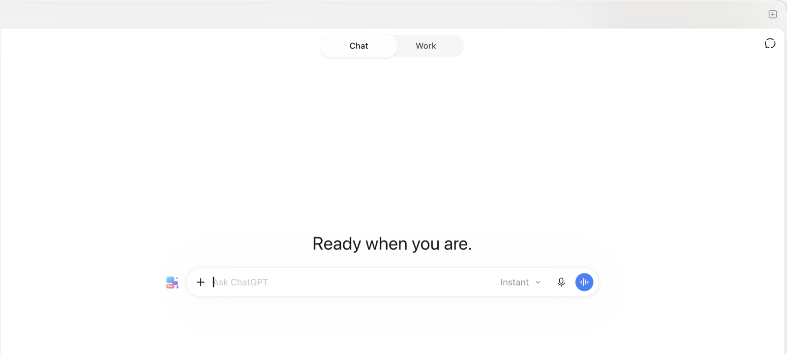
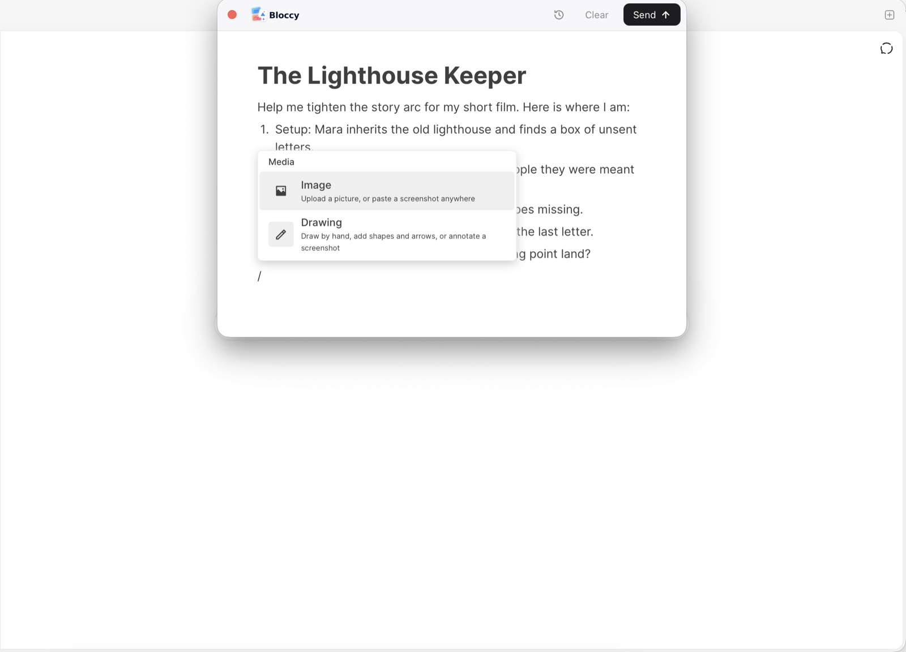

<p align="center"></p>
<p align="center"><strong>A canvas for your next conversation</strong></p>

<p align="center">
  
  <a href="../../releases/latest"></a>
  
  
  
</p>

## Show AI what you mean

AI can understand text, images, drawings, and voice. So why are we still talking to it through a text box?

Bloccy gives you a canvas to communicate with AI the way you naturally explain things: combining words, screenshots, sketches, annotations, and voice notes into a single message.

Circle something that needs fixing. Sketch an idea. Put screenshots side by side. Record a quick voice note instead of typing a long explanation. Bring everything together so AI can better understand what you're trying to communicate.

Bloccy works right inside your existing ChatGPT, Claude and T3 Code conversations. No new chat app, no switching tools. Just a better way to get your point across.

Works with the **ChatGPT**, **Claude** and **T3 Code** desktop apps, and with chatgpt.com and claude.ai in Chrome.

This repository is for downloads and feedback. Bloccy is in early testing.

<table>
  <tr>
    <td width="50%" align="center"><br><sub>The Bloccy icon, next to the chat box</sub></td>
    <td width="50%" align="center"><br><sub>The Bloccy canvas</sub></td>
  </tr>
</table>

## Install

Apple Silicon, macOS 14 or later.

1. Download the zip from [Releases](../../releases/latest) and move **Bloccy** to Applications.
2. Open it. The first time, macOS blocks it: click **Open Anyway** in **System Settings › Privacy & Security**.
3. Allow **Accessibility** when asked.

Bloccy lives in the menu bar and updates itself.

## Use it

- **Open:** press **⌃⌥B**, or click the Bloccy icon next to the chat box in ChatGPT, Claude or T3 Code. Anything you'd already typed in the chat box comes along into the canvas.
- **Write:** type, and press **/** to add an image or a drawing. Paste screenshots straight in. Pick or drop several images to put them side by side.
- **Send:** **⌘↩** puts everything in the chat box and sends it. **⇧⌘↩** only puts it in, so you can review it first.
- **History:** the clock icon keeps your last message, so you can restore it or send it again.

## How it works

You write your message the way you'd explain it in person: some text, then a screenshot, a sketch, more text. Bloccy keeps that order when it sends.

Every image and drawing becomes a numbered figure. The text gets a marker like **[Figure 1]** exactly where the image sat, and the same label is drawn into the corner of the image. So the AI reads your message in the right sequence and knows which image you mean at each point, instead of getting a pile of attachments and a block of text to piece together.

For the message in the screenshot above, ChatGPT receives this text:

```text
Help me tighten the story arc for my short film. Here is where I am:

1. Setup: Mara inherits the old lighthouse and finds a box of unsent letters.
2. Rising action: the letters lead her to the people they were meant for, as a storm closes in.
3. Climax: the lamp fails on the night a boat goes missing.
4. Resolution: she relights it and finally sends the last letter.

The middle feels slow. Where should the turning point land?

[Figure 1]

The look I am going for:

[Figure 2] [Figure 3] [Figure 4]
```

with four images attached: the drawing labelled **Figure 1** and the three photos labelled **Figure 2** to **4**.

Then Bloccy puts it all in the chat box of the app you're using and sends it, or leaves it there for you to review first.

In **T3 Code**, your sent message looks like your canvas: each figure shows inline where it sat, and figures side by side share a row. The AI still gets every figure in full, with its number.

## Roadmap

**In 0.1**
- [x] Composer that opens over the chat box in ChatGPT and Claude (desktop apps, and the websites in Chrome)
- [x] Text, images (several side by side), drawings and annotated screenshots in one message
- [x] Send in one step, or insert only to review first
- [x] Last-message history, About, Open at Login
- [x] Automatic updates
- [x] T3 Code, with figures shown inline in the sent message (0.1.2)
- [x] Text you'd already typed in the chat box comes into the canvas (0.1.2)

**Next**
- [ ] Voice notes: record a quick explanation instead of typing it
- [ ] Sharper drawings and annotated screenshots (full-resolution export)
- [ ] A clear message for files Bloccy can't send yet, such as videos
- [ ] More apps: VS Code
- [ ] More browsers: Safari and Arc

**Ideas**
- [ ] Capture a screenshot from inside Bloccy
- [ ] Code blocks
- [ ] Open-source the code

Have an idea or a request? [Open an issue](../../issues).

## Privacy

Bloccy runs entirely on your Mac. It has no account and no server, and it sends nothing anywhere except into the chat app you're using, when you press Send. Your draft is saved locally in `~/Library/Application Support/Bloccy`. For T3 Code, which shows figures from files on your Mac, Bloccy also keeps a small copy of each figure there for a week, then deletes it.

## Uninstall

Quit Bloccy from the menu bar, move it to the Trash, remove it from the Accessibility list in System Settings, and delete `~/Library/Application Support/Bloccy`.

## Feedback

Found a bug or have an idea? [Open an issue](../../issues).
