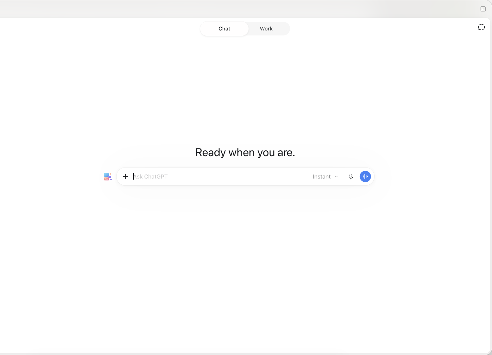
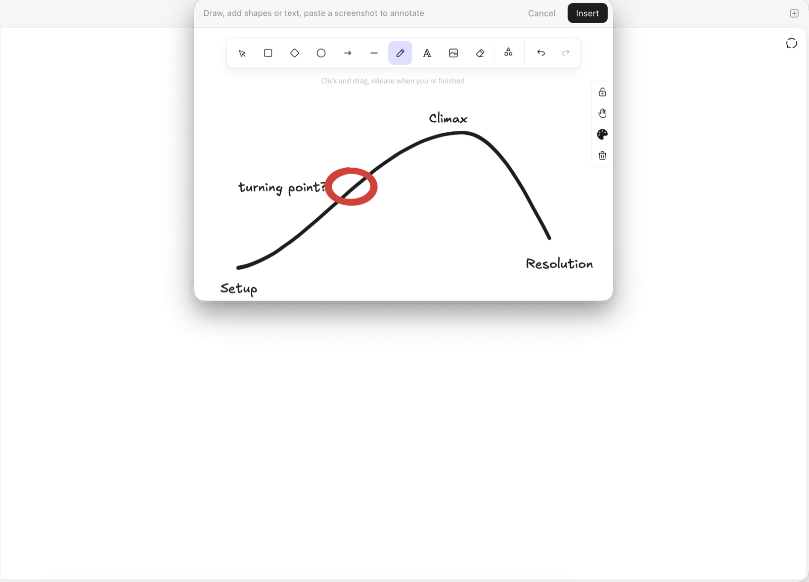
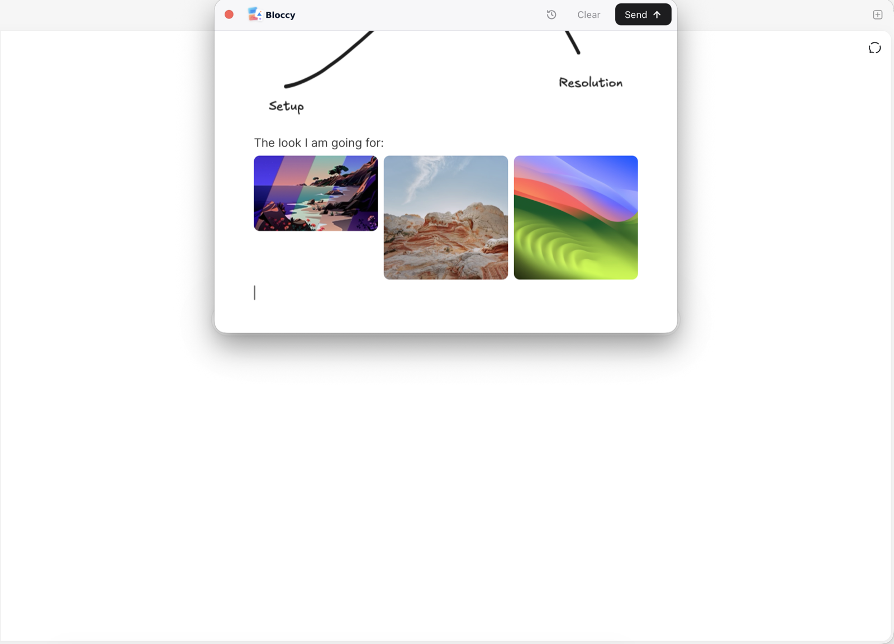
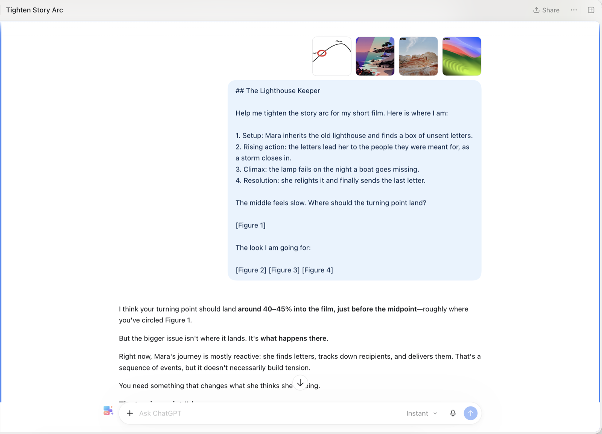

<strong>A canvas for your next conversation</strong>

## Show AI what you mean

AI can understand text, images, drawings, and voice. So why are we still talking to it through a text box?

Bloccy gives you a canvas to communicate with AI the way you naturally explain things: combining words, screenshots, sketches, annotations, and voice notes into a single message.

Circle something that needs fixing. Sketch an idea. Put screenshots side by side. Record a quick voice note instead of typing a long explanation. Bring everything together so AI can better understand what you're trying to communicate.

Bloccy works right inside your existing ChatGPT and Claude conversations. No new chat app, no switching tools. Just a better way to get your point across.

Works with the **ChatGPT** and **Claude** desktop apps, and with chatgpt.com and claude.ai in Chrome.

This repository is for downloads and feedback. Bloccy is in early testing.

<table>
  <tr>
    <td width="50%"> Click the Bloccy icon next to the chat box</td>
    <td width="50%"> Write your message</td>
  </tr>
  <tr>
    <td> Press / to add an image or a drawing</td>
    <td> Sketch it, or annotate a screenshot</td>
  </tr>
  <tr>
    <td> Put images side by side</td>
    <td> Send it all to ChatGPT in one step</td>
  </tr>
</table>

## Install

Apple Silicon, macOS 14 or later.

1. Download the zip from [Releases](../../releases/latest) and move **Bloccy** to Applications.
2. Open it. The first time, macOS blocks it: click **Open Anyway** in **System Settings › Privacy & Security**.
3. Allow **Accessibility** when asked.

Bloccy lives in the menu bar and updates itself.

## Use it

- **Open:** press **⌃⌥B**, or click the Bloccy icon next to the chat box in ChatGPT or Claude.
- **Write:** type, and press **/** to add an image or a drawing. Paste screenshots straight in. Pick or drop several images to put them side by side.
- **Send:** **⌘↩** puts everything in the chat box and sends it. **⇧⌘↩** only puts it in, so you can review it first.
- **History:** the clock icon keeps your last message, so you can restore it or send it again.

## Roadmap

**In 0.1**
- [x] Composer that opens over the chat box in ChatGPT and Claude (desktop apps, and the websites in Chrome)
- [x] Text, images (several side by side), drawings and annotated screenshots in one message
- [x] Send in one step, or insert only to review first
- [x] Last-message history, About, Open at Login
- [x] Automatic updates

**Next**
- [ ] Voice notes: record a quick explanation instead of typing it
- [ ] Sharper drawings and annotated screenshots (full-resolution export)
- [ ] A clear message for files Bloccy can't send yet, such as videos
- [ ] More apps: T3 Code and VS Code
- [ ] More browsers: Safari and Arc

**Ideas**
- [ ] Capture a screenshot from inside Bloccy
- [ ] Code blocks
- [ ] Open-source the code

Have an idea or a request? [Open an issue](../../issues).

## Privacy

Bloccy runs entirely on your Mac. It has no account and no server, and it sends nothing anywhere except into the chat app you're using, when you press Send. Your draft is saved locally in `~/Library/Application Support/Bloccy`.

## Uninstall

Quit Bloccy from the menu bar, move it to the Trash, and remove it from the Accessibility list in System Settings.

## Feedback

Found a bug or have an idea? [Open an issue](../../issues).
